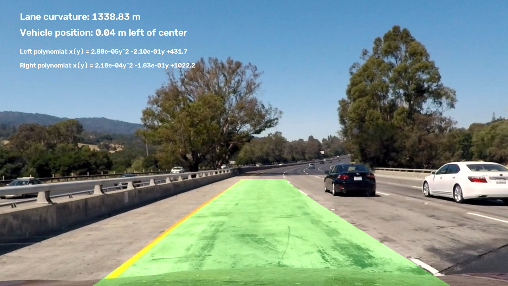

# Lane Finding Project

This project implements a lane detection pipeline using Python and OpenCV. It detects road lane boundaries in images and videos, estimates lane curvature and vehicle position, and visualizes the detected lane area.

## Technologies Used

- Python
- OpenCV
- NumPy
- Matplotlib

## Example Result



## Running the Project

Install dependencies:

```bash
pip install -r requirements.txt
```

Process images:

```bash
python src/image_pipline.py
```

Process videos:

```bash
python src/video_pipeline.py
```

Processed results are available in the `output_images/` and `output_videos/` directories.

## Documentation

For a detailed explanation of the implementation, processing steps, results, and challenges, see:

**[Project Documentation](./writeup_template.md)**